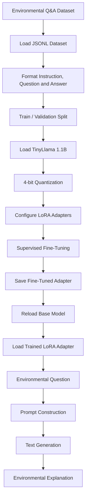

# 🌍 Air Quality & Climate Assistant using TinyLlama and QLoRA

An AI-powered environmental question-answering assistant fine-tuned to explain **air quality, PM2.5 pollution, climate change, ENSO (El Niño–Southern Oscillation), pollution meteorology, atmospheric conditions, and environmental science** using a large language model.

This project uses **TinyLlama-1.1B-Chat-v1.0**, parameter-efficient fine-tuning with **QLoRA and LoRA**, the Hugging Face Transformers ecosystem, and a structured question-answering dataset. It demonstrates how a compact language model can be adapted to a specialized environmental knowledge domain without updating all of its parameters.

---

## 📌 Table of Contents

- [Project Overview](#-project-overview)
- [Problem Statement](#-problem-statement)
- [Project Objectives](#-project-objectives)
- [Key Features](#-key-features)
- [Technology Stack](#-technology-stack)
- [System Architecture](#-system-architecture)
- [Model and Fine-Tuning Approach](#-model-and-fine-tuning-approach)
- [Dataset Description](#-dataset-description)
- [Project Workflow](#-project-workflow)
- [Getting Started](#-getting-started)
- [Training the Model](#-training-the-model)
- [Using the Fine-Tuned Model](#-using-the-fine-tuned-model)
- [Example Questions](#-example-questions)
- [Evaluation Strategy](#-evaluation-strategy)
- [Project Structure](#-project-structure)
- [Hardware Requirements](#-hardware-requirements)
- [Limitations](#-limitations)
- [Future Improvements](#-future-improvements)
- [Responsible Use](#-responsible-use)
- [References](#-references)
- [License](#-license)

---

## 🌱 Project Overview

Air quality and climate systems are influenced by multiple interconnected environmental factors. Pollutant concentrations can change because of atmospheric stability, temperature inversions, boundary-layer height, regional transport, and large-scale climate variability, even when emissions remain relatively constant.

Understanding these relationships requires more than simply defining environmental terms. It requires explaining how atmospheric and climatic processes interact.

This project explores the use of a small language model to provide accessible explanations of these concepts.

The notebook implements a pipeline that:

1. Loads a structured environmental question-answering dataset.
2. Prepares examples in an instruction-following format.
3. Loads a pretrained TinyLlama language model.
4. Configures 4-bit quantization to reduce model memory requirements.
5. Applies LoRA adapters for parameter-efficient fine-tuning.
6. Trains the model using supervised fine-tuning.
7. Saves the trained adapter and tokenizer.
8. Reloads the fine-tuned model for inference.
9. Generates responses to environmental questions.

The resulting system is intended as an educational assistant for environmental science concepts, not as a replacement for official pollution-monitoring systems or scientific forecasting tools.

## 🎯 Problem Statement

Air pollution is affected by both emission sources and atmospheric conditions. For example, PM2.5 concentrations can rise when the atmospheric boundary layer becomes shallow, or when a temperature inversion limits the vertical mixing of pollutants.

Similarly, climate phenomena such as El Niño can influence regional temperature, precipitation, wind patterns, and other conditions relevant to air quality.

These relationships are often difficult for non-specialists to understand.

The goal of this project is to investigate whether a compact pretrained language model can be adapted to answer domain-specific environmental questions in a clear, structured, and accessible manner.

## 🎯 Project Objectives

- Develop a domain-focused AI assistant for air quality and climate education.
- Explore the adaptation of a pretrained language model using environmental question-answer pairs.
- Apply QLoRA to reduce the memory requirements associated with fine-tuning.
- Use LoRA adapters to update a limited set of model parameters.
- Implement a reusable inference function for answering environmental questions.
- Examine model responses to questions involving atmospheric processes and climate variability.
- Establish a foundation for future integration with real-world environmental datasets and monitoring systems.

## ✨ Key Features

| Feature | Description |
|---|---|
| Domain-specific question answering | Focuses on environmental science, air quality, and climate topics. |
| Compact language model | Uses TinyLlama-1.1B-Chat-v1.0 as the base model. |
| 4-bit quantization | Loads the base model using a 4-bit bitsandbytes configuration. |
| Parameter-efficient fine-tuning | Uses LoRA adapters rather than full-model fine-tuning. |
| Supervised fine-tuning | Trains on formatted instruction, question, and answer examples. |
| Train-validation split | Reserves 10% of the dataset for evaluation. |
| Model persistence | Saves the fine-tuned model adapter and tokenizer. |
| Reusable inference function | Allows users to submit their own environmental questions. |
| Batch question testing | Evaluates a collection of representative environmental questions. |

---

## 🛠️ Technology Stack

| Technology | Purpose |
|---|---|
| Python | Core programming language |
| PyTorch | Model execution and training |
| Hugging Face Transformers | Loading the pretrained model and tokenizer |
| Hugging Face Datasets | Loading and preparing the dataset |
| PEFT | Parameter-efficient fine-tuning and LoRA adapters |
| bitsandbytes | 4-bit model quantization |
| TRL | Supervised fine-tuning using `SFTTrainer` |
| Accelerate | Model placement and training support |
| Google Colab / CUDA GPU | Recommended environment for experimentation |

### Base Model

**TinyLlama-1.1B-Chat-v1.0**

The project uses a pretrained instruction-oriented language model as its starting point. The base model provides general language-generation capabilities, while fine-tuning adapts its behavior to the environmental question-answering dataset.

Model page: https://huggingface.co/TinyLlama/TinyLlama-1.1B-Chat-v1.0

---

## 🏗️ System Architecture

The project has two main stages: model training and question answering.



### Training Pipeline

The dataset is loaded and transformed into a consistent text format. The model is then prepared for parameter-efficient training, and the training process updates its LoRA adapter parameters using the training examples.

### Inference Pipeline

A user submits a question. The application constructs a prompt with environmental-assistant instructions, tokenizes it, generates a response using the fine-tuned model, and decodes the generated tokens into text.

---

## 🧠 Model and Fine-Tuning Approach

### 1. TinyLlama

TinyLlama is a compact language model suitable for experimentation with language-model adaptation. Using a relatively small base model makes this project more accessible than full fine-tuning of a much larger language model, although GPU memory and runtime requirements still depend on the configuration.

### 2. Quantization

The notebook uses a 4-bit `BitsAndBytesConfig` with the following settings:

- `load_in_4bit=True`
- `bnb_4bit_quant_type="nf4"`
- `bnb_4bit_compute_dtype=torch.float16`
- `bnb_4bit_use_double_quant=True`

**Why quantization?**

Quantization reduces the memory needed to represent the base model's weights. This can make it possible to adapt models on hardware that would not support conventional full-precision fine-tuning.

The notebook uses the NF4 quantization format and double quantization. The actual memory savings and training speed depend on the hardware, software versions, and model configuration.

### 3. LoRA

Low-Rank Adaptation (LoRA) is a parameter-efficient fine-tuning technique. Instead of updating every parameter of the pretrained model, it introduces trainable low-rank matrices into selected model layers.

The notebook configures LoRA with:

| Parameter | Value |
|---|---|
| Rank (`r`) | 16 |
| Alpha (`lora_alpha`) | 32 |
| Dropout (`lora_dropout`) | 0.05 |
| Bias | `none` |
| Task type | `CAUSAL_LM` |
| Target modules | `q_proj`, `k_proj`, `v_proj`, `o_proj` |

This configuration applies adapters to selected attention projection layers.

### 4. QLoRA

QLoRA combines a quantized base model with trainable LoRA adapters. In this project, the base model is loaded in 4-bit precision, while supervised fine-tuning is performed using the configured adapter.

This approach is designed to reduce the memory footprint of model adaptation compared with updating the entire model.

### 5. Supervised Fine-Tuning

The notebook uses TRL's `SFTTrainer` and `SFTConfig` for supervised fine-tuning.

The configured training parameters include:

| Parameter | Value |
|---|---|
| Epochs | 2 |
| Per-device training batch size | 1 |
| Per-device evaluation batch size | 1 |
| Gradient accumulation steps | 8 |
| Learning rate | 0.0002 |
| Maximum sequence length | 256 tokens |
| Logging interval | Every 10 steps |
| Evaluation strategy | Every 200 steps |
| Checkpoint saving | Every 200 steps |
| Maximum saved checkpoints | 1 |

These are the settings specified in the notebook. They are not claims about achieved accuracy, final model quality, or completed training performance.

---

## 📚 Dataset Description

The notebook loads a JSON Lines dataset named:

`air_quality_climate_synthetic_3000.jsonl`

The filename suggests a collection of 3,000 synthetic examples. The dataset file itself must be supplied separately; it is not embedded in the notebook.

The code expects the records to contain three fields:

| Field | Description |
|---|---|
| `instruction` | Instructions describing the expected response behavior |
| `input` | The environmental question or input |
| `output` | The target answer used for supervised training |

### Example Dataset Record

The following illustrates the expected schema. It is an example of the format, not a verified record from the original dataset.

```json
{
  "instruction": "Explain environmental science concepts clearly and accurately.",
  "input": "What is a temperature inversion?",
  "output": "A temperature inversion occurs when temperature increases with altitude over a layer of the atmosphere, potentially limiting vertical mixing and allowing pollutants to accumulate near the surface."
}
```

### Dataset Preparation

The notebook formats each example using this structure:

```text
### Instruction:
{instruction}

### Question:
{input}

### Answer:
{output}
```

The formatted dataset is split into:

- **90% training data**
- **10% validation data**

The split uses `seed=42` to make the partition reproducible for the same input dataset and dataset-processing setup.

### Dataset Considerations

Because the dataset is described as synthetic, the quality of the fine-tuned model depends heavily on how accurately and comprehensively those examples represent environmental science.

Before using the model for scientific applications, review the dataset for factual correctness, duplicate examples, misleading statements, and gaps in subject coverage.

---

## 🚀 Getting Started

### Option 1: Google Colab

Google Colab with a compatible GPU is the recommended starting point for this notebook.

1. Upload `AI_CORE_LAB_Exam.ipynb` to Google Colab.
2. Select **Runtime → Change runtime type**.
3. Choose a GPU runtime if available.
4. Upload `air_quality_climate_synthetic_3000.jsonl` to the Colab session, or configure an appropriate dataset source.
5. Execute the notebook cells in order.

Check the available GPU before training:

```python
!nvidia-smi
```

```python
import torch

print("PyTorch version:", torch.__version__)
print("CUDA available:", torch.cuda.is_available())

if torch.cuda.is_available():
    print("GPU:", torch.cuda.get_device_name(0))
```

The notebook uses CUDA-oriented 4-bit quantization, so a compatible GPU and software environment are important.

### Option 2: Local Environment

A local CUDA-enabled environment may also work, provided the installed Python, PyTorch, CUDA, bitsandbytes, Transformers, PEFT, and TRL versions are mutually compatible.

Create and activate a virtual environment:

```bash
python -m venv .venv
```

On Windows:

```powershell
.venv\Scripts\Activate.ps1
```

On Linux or macOS:

```bash
source .venv/bin/activate
```

Install the main dependencies:

```bash
python -m pip install --upgrade pip

pip install torch transformers datasets peft accelerate bitsandbytes trl
```

**Important:** These commands install the current compatible releases available to your package environment, not necessarily the exact versions used during the original notebook run. For reproducible results, pin and test the versions that work in your environment.

The notebook also installs or upgrades some packages in separate cells. Avoid changing package versions in the middle of an active training session unless the runtime is restarted and the compatibility of the complete environment is verified.

---

## 🏋️ Training the Model

### Step 1: Load the Dataset

```python
from datasets import load_dataset

dataset = load_dataset(
    "json",
    data_files="air_quality_climate_synthetic_3000.jsonl"
)

print(dataset)
print(dataset["train"][0])
```

Ensure the dataset file exists at the specified path.

### Step 2: Format the Examples

```python
def format_example(example):
    text = f"""### Instruction:
{example['instruction']}

### Question:
{example['input']}

### Answer:
{example['output']}"""

    return {"text": text}


formatted_dataset = dataset["train"].map(format_example)
```

### Step 3: Create Training and Validation Splits

```python
split_dataset = formatted_dataset.train_test_split(
    test_size=0.1,
    seed=42
)

train_dataset = split_dataset["train"]
eval_dataset = split_dataset["test"]

print("Training:", len(train_dataset))
print("Validation:", len(eval_dataset))
```

### Step 4: Configure Quantization and Load the Model

The notebook defines a 4-bit quantization configuration and loads the TinyLlama base model with automatic device placement.

### Step 5: Configure LoRA

The notebook applies a LoRA configuration targeting the query, key, value, and output projection layers.

### Step 6: Configure the Trainer

The training configuration specifies the learning rate, number of epochs, batch sizes, gradient accumulation, evaluation schedule, and maximum sequence length.

### Step 7: Start Training

```python
trainer.train()
```

Training time and memory consumption depend on the GPU, dataset size, sequence lengths, and software environment.

### Step 8: Save the Model

```python
output_dir = "./air_quality_climate_qlora"

trainer.save_model(output_dir)
tokenizer.save_pretrained(output_dir)

print("QLoRA model saved at:", output_dir)
```

The output directory contains the fine-tuned adapter artifacts and tokenizer files required by the notebook's loading workflow.

**Note:** With PEFT, the saved model is generally an adapter rather than a complete standalone copy of the base model. Keep the base model identifier and the adapter directory available when loading the trained model.

---

## 💬 Using the Fine-Tuned Model

After training, the notebook reloads the TinyLlama base model, loads the saved LoRA adapter, and defines an inference function.

The following is a representative usage pattern based on that notebook:

```python
from peft import PeftModel
from transformers import (
    AutoModelForCausalLM,
    AutoTokenizer,
    BitsAndBytesConfig
)
import torch

base_model_name = "TinyLlama/TinyLlama-1.1B-Chat-v1.0"
output_dir = "./air_quality_climate_qlora"

bnb_config = BitsAndBytesConfig(
    load_in_4bit=True,
    bnb_4bit_quant_type="nf4",
    bnb_4bit_compute_dtype=torch.float16,
    bnb_4bit_use_double_quant=True
)

base_model = AutoModelForCausalLM.from_pretrained(
    base_model_name,
    quantization_config=bnb_config,
    device_map="auto"
)

tokenizer = AutoTokenizer.from_pretrained(output_dir)

model = PeftModel.from_pretrained(
    base_model,
    output_dir
)

model.eval()
```

### Inference Function

```python
def ask_climate_assistant(question):
    prompt = f"""### Instruction:
You are an air-quality and climate assistant.
Explain ENSO, PM2.5, pollution meteorology,
climate change and environmental science accurately and clearly.

### Question:
{question}

### Answer:
"""

    inputs = tokenizer(
        prompt,
        return_tensors="pt"
    ).to(model.device)

    with torch.no_grad():
        outputs = model.generate(
            **inputs,
            max_new_tokens=200,
            do_sample=True,
            temperature=0.7,
            top_p=0.9,
            pad_token_id=tokenizer.eos_token_id
        )

    # Decode only newly generated tokens.
    generated_tokens = outputs[0][inputs["input_ids"].shape[1]:]

    return tokenizer.decode(
        generated_tokens,
        skip_special_tokens=True
    ).strip()
```

### Ask a Question

```python
question = "How does El Niño affect PM2.5 pollution?"

answer = ask_climate_assistant(question)

print("Question:", question)
print("Answer:", answer)
```

This inference example decodes only the newly generated tokens, avoiding the repetition of the input prompt in the displayed answer.

---

## 🧪 Example Questions

The notebook tests the model with questions across several environmental topics.

| Topic | Example question |
|---|---|
| Climate variability | What is El Niño and how can it affect air pollution? |
| Fine particulate pollution | Why can PM2.5 increase even when emissions remain unchanged? |
| Atmospheric stability | What is a temperature inversion? |
| Boundary-layer meteorology | How does a shallow boundary layer affect pollution? |
| Regional transport | What is regional pollution transport? |
| Air quality management | What is an airshed? |
| Climate and agriculture | How can climate-zone shifts affect agriculture? |
| Environmental policy | Why should pollution policies consider weather conditions? |

Run the batch evaluation:

```python
questions = [
    "What is El Niño and how can it affect air pollution?",
    "Why can PM2.5 increase even when emissions remain unchanged?",
    "What is a temperature inversion?",
    "How does a shallow boundary layer affect pollution?",
    "What is regional pollution transport?",
    "What is an airshed?",
    "How can climate-zone shifts affect agriculture?",
    "Why should pollution policies consider weather conditions?"
]

for question in questions:
    print("=" * 80)
    print("QUESTION:", question)
    print("ANSWER:", ask_climate_assistant(question))
    print()
```

These questions provide a basic qualitative test set for checking whether the assistant responds to the intended environmental topics.

The generated answers should be inspected for scientific accuracy, completeness, clarity, and unsupported claims.

---

## 📊 Evaluation Strategy

The notebook creates a validation split and configures periodic evaluation during training. It also generates answers to a fixed collection of environmental questions.

However, a successful training run or a plausible-looking answer does not by itself establish that the model is scientifically reliable.

A more complete evaluation should include:

- **Factual accuracy:** Are scientific explanations correct?
- **Relevance:** Does the answer directly address the question?
- **Completeness:** Does it explain the important mechanisms?
- **Clarity:** Can a non-specialist understand the explanation?
- **Consistency:** Does the model give compatible explanations to related questions?
- **Hallucination rate:** Does it invent measurements, citations, or scientific relationships?
- **Baseline comparison:** How do the fine-tuned model's answers differ from those of the original TinyLlama model?
- **Held-out testing:** Does the model generalize to questions not represented in the training examples?

Where possible, use expert-reviewed reference answers and a held-out test set that is separate from both the training and validation sets.

No numerical accuracy, benchmark score, or performance improvement is claimed here because the notebook content alone does not establish those results.

---

## 📁 Project Structure

A suggested GitHub repository structure is:

```text
air-quality-climate-assistant/
│
├── AI_CORE_LAB_Exam.ipynb
│
├── data/
│   └── air_quality_climate_synthetic_3000.jsonl
│
├── air_quality_climate_qlora/
│   ├── adapter_config.json
│   ├── adapter_model.safetensors
│   └── tokenizer files
│
├── requirements.txt
├── .gitignore
├── LICENSE
└── README.md
```

The structure above is a suggested organization, not a claim that all these files already exist in the repository. Actual saved filenames may vary with the installed library versions.

### Recommended `.gitignore`

```gitignore
# Python
__pycache__/
*.py[cod]
.venv/
venv/

# Jupyter
.ipynb_checkpoints/

# Training checkpoints and temporary outputs
checkpoint-*/
runs/
wandb/

# Model artifacts (uncomment if you do not intend to commit them)
# air_quality_climate_qlora/
# *.safetensors
# *.bin

# Local datasets
# data/*.jsonl

# Environment and secrets
.env
```

Large model files and datasets can make Git repositories difficult to clone. Consider using Git LFS or the Hugging Face Hub for model artifacts, and provide a clear download or preparation procedure for datasets that cannot be distributed directly.

Do not upload credentials, private data, or datasets that you do not have permission to redistribute.

---

## 💻 Hardware Requirements

The project uses 4-bit quantization to reduce memory usage, but the notebook is not guaranteed to run on every computer.

| Resource | Recommendation |
|---|---|
| Operating system | Linux or Windows with a compatible GPU setup, or a managed notebook environment |
| Python | A version compatible with the selected PyTorch and Hugging Face packages |
| GPU | A CUDA-compatible GPU supported by the installed bitsandbytes configuration |
| GPU memory | Depends on model loading, training settings, and runtime overhead |
| Storage | Enough space for model downloads, datasets, checkpoints, and outputs |
| Internet | Needed to download the base model and dependencies unless cached locally |

For most users, a GPU-enabled Google Colab runtime is a convenient starting point. CPU-only execution of the entire QLoRA training workflow is not the intended configuration of this notebook.

---

## ⚠️ Limitations

1. **Synthetic data dependence:** The model's domain behavior depends on the accuracy and coverage of the supplied training dataset.
2. **No live environmental monitoring:** The notebook does not retrieve current PM2.5 readings, weather observations, or satellite measurements.
3. **No forecasting module:** It does not implement a dedicated air-quality forecasting or climate-prediction model.
4. **Potential hallucinations:** The language model can generate incorrect or unsupported scientific explanations.
5. **No established benchmark results:** Quantitative performance must be measured through a reproducible evaluation process.
6. **Hardware dependence:** Quantization and training compatibility vary across devices and software versions.
7. **Limited sequence length:** The configured maximum sequence length is 256 tokens, which may restrict the context available for longer examples.
8. **Generation variability:** Sampling settings can produce different responses to the same question.
9. **No guarantee of generalization:** Fine-tuning on a small or synthetic dataset does not guarantee robust performance on unseen scientific questions.

---

## 🚀 Future Improvements

Potential extensions include:

- Integrate real-time air-quality measurements from trusted monitoring APIs.
- Add weather observations such as temperature, wind speed, humidity, and boundary-layer height.
- Expand and validate the environmental question-answering dataset.
- Evaluate the model against expert-reviewed questions and answers.
- Compare base-model and fine-tuned-model performance quantitatively.
- Experiment with retrieval-augmented generation (RAG) using trusted environmental reports and scientific publications.
- Add citations and source retrieval to improve traceability.
- Develop a Streamlit, Flask, or FastAPI interface for interactive use.
- Build a dashboard showing PM2.5 trends alongside meteorological variables.
- Improve answer generation and test different sequence lengths and generation settings.
- Publish model adapters and reproducible training configurations where licensing permits.

---

## 🌏 Responsible Use

This project is intended for **education, experimentation, and research into domain-specific language-model fine-tuning**.

Generated answers should not be treated as official air-quality measurements, emergency alerts, regulatory assessments, or professional scientific advice. For health and safety decisions, consult official environmental monitoring agencies and qualified professionals.

Any future deployment should include factual validation, clear limitations, appropriate source attribution, and monitoring for incorrect or misleading responses.

---

## 📖 References

1. **TinyLlama — TinyLlama-1.1B-Chat-v1.0**  
   https://huggingface.co/TinyLlama/TinyLlama-1.1B-Chat-v1.0

2. **Hugging Face Transformers Documentation**  
   https://huggingface.co/docs/transformers

3. **Hugging Face Datasets Documentation**  
   https://huggingface.co/docs/datasets

4. **PEFT Documentation**  
   https://huggingface.co/docs/peft

5. **TRL Documentation**  
   https://huggingface.co/docs/trl

6. **bitsandbytes Documentation**  
   https://huggingface.co/docs/bitsandbytes

7. **LoRA: Low-Rank Adaptation of Large Language Models**  
   https://arxiv.org/abs/2106.09685

8. **QLoRA: Efficient Finetuning of Quantized LLMs**  
   https://arxiv.org/abs/2305.14314

---

## 👨‍💻 Author and Contributions

This project is an experimental implementation of parameter-efficient fine-tuning for environmental question answering.

Contributions, suggestions, dataset improvements, reproducibility tests, and evaluation enhancements are welcome.

To contribute:

1. Fork the repository.
2. Create a feature branch.
3. Make and test your changes.
4. Submit a pull request describing the improvement.

---

## ⭐ Support the Project

If you find this project useful for learning about language models, QLoRA, or environmental AI, consider starring the repository and sharing feedback.

**Built to explore the intersection of Generative AI, efficient fine-tuning, and environmental science.**
